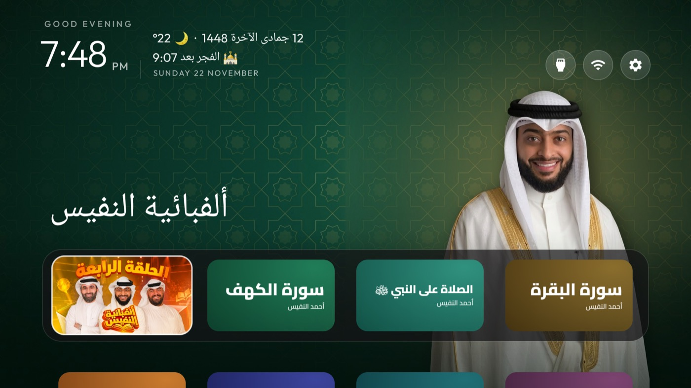
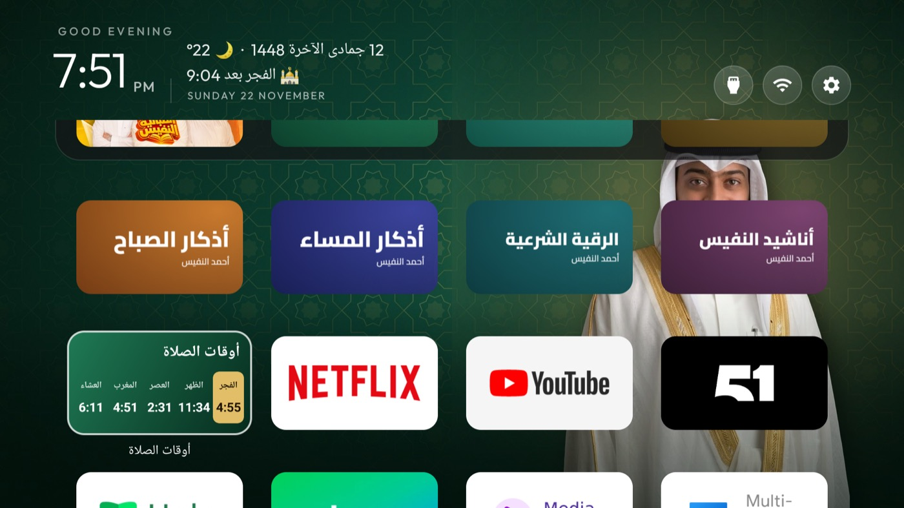

<div dir="rtl" align="center">

# 📺 النفيس تي في

### شاشة الشيخ أحمد النفيس على تلفزيونك: ألفبائية النفيس، وتلاواته، والأذان بصوته

مأخوذ من [نور تي في](https://github.com/majedphotos/noor-tv). كلود يركّبه ويمشّيك خطوة خطوة.



</div>

<div dir="rtl">

## شنو فيه؟

- 🎬 **ألفبائية النفيس أول كرت:** يطلع عليه ثمب آخر حلقة، وتضغطه تفتح آخر حلقة على طول.
- 📖 **كروت بصوت الشيخ:** سورة الكهف، الصلاة على النبي ﷺ، سورة البقرة، أذكار الصباح، أذكار المساء، الرقية الشرعية، وأناشيد الشيخ.
- 🕌 **الأذان بصوت الشيخ على وقت مدينتك:** كلود يعرف مدينتك من جهازك ويأكّدها معاك.
- 🕰️ **كرت أوقات الصلاة:** أوقات اليوم الخمسة، والصلاة الجاية بالذهبي.
- 🌧️ **دعاء الطقس:** لو تمطر أو ترعد أو الريح قوية، يطلع الدعاء الوارد فوق الساعة.
- 🌿 **الجمعة:** تذكير بالكهف والصلاة على النبي ﷺ، والأيام البيض.
- 💌 **من جوالك:** تكتب أو ترسم ويطلع على التلفزيون.
- 🧹 **بلا إعلانات:** يعطّل تطبيقات الشركة (**تعطيل مو حذف**، وترجع بأمر واحد).



## خلفيتين، اختار اللي تحبها


**بصورة الشيخ** أو **الزخرفة بلا صورة**. كلود يسألك وقت التركيب، وتقدر تغيّرها بعدين بأي وقت.

## كل الروابط بملف واحد

[`sources.json`](sources.json): كل مقطع من [قناة الشيخ الرسمية الموثّقة](https://www.youtube.com/@Ahmad_Alnufais). تبي تغيّر مقطع؟ غيّره هناك وركّب من جديد.

## يشتغل على شنو؟

✅ أندرويد تي في وقوقل تي في (تي سي إل، سوني، شاومي، تشانغهونغ، هايسنس أندرويد...)
❌ سامسونق وإل جي (أنظمتهم مو أندرويد)

<a name="start"></a>
## الطريقة: 3 خطوات

**تحتاج:** لابتوب (ماك أو ويندوز) فيه [كلود كود](https://claude.com/claude-code)، والتلفزيون واللابتوب على **نفس الواي فاي**.

**1. افتح كلود كود والصق هالسطر:**

```
ركّب النفيس تي في على تلفزيوني من github.com/majedphotos/nafees-tv واقرا skills/nafees-tv/SKILL.md وامشِ عليه خطوة خطوة
```

**2. سوّ اللي يقول لك.** خطوة وحدة بكل مرة. الشي الوحيد اللي تسويه بإيدك: خيارات المطوّر بالتلفزيون (Developer options)، وكلود يقول لك وينها بالعربي والإنقليزي.

**3. خلاص.** كلود يعرف مدينتك عشان الأذان والأوقات، ويسألك أي خلفية تبي، ويعطيك رابط صفحة الجوال.

<details>
<summary>تبيه كبلقن بكلود كود؟</summary>

```
/plugin marketplace add majedphotos/nafees-tv
/plugin install nafees-tv@nafees-tv
```

بعدها قول لكلود: «ركّب النفيس تي في على تلفزيوني».
</details>

## ⚠️ اقرا قبل ما تبدي

- **الحقوق:** الصوتيات والصور حق الشيخ أحمد النفيس، وانشر هالمشروع بإذنه. لا تستخدم صورته أو صوته بمكان ثاني.
- **عطّل لا تحذف.** هالمشروع ما يحذف شي من التلفزيون أبداً.
- قبل أي تغيير تنحفظ نسخة احتياطية، ومعاها أمر يرجّع كل شي.

## شكر

مبني على [نور تي في](https://github.com/majedphotos/noor-tv) و[CleanYourTV](https://github.com/Gathin23/cleanyourtv) (رخصة MIT).
المواقيت والهجري من [Aladhan](https://aladhan.com)، والطقس من [Open-Meteo](https://open-meteo.com).

</div>
